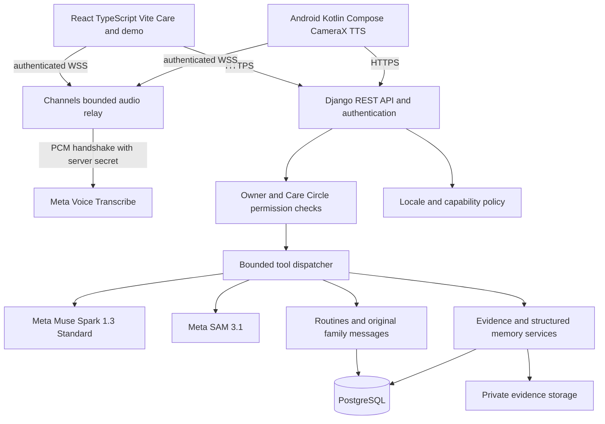
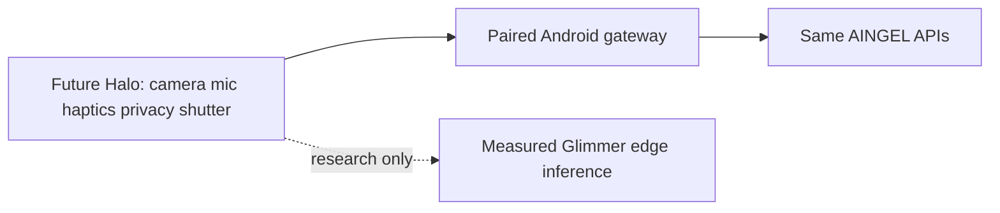

# AINGEL architecture — initial design, 2026-10-26

Adaptive Intelligence for Navigation, Guidance & Everyday Living. One multimodal companion with evidence-backed memory. Evidence before assertion.

## Proposed production topology

## Decisions

Use Kotlin/Compose/CameraX/AudioRecord/OkHttp/Android TTS for Android, React/TypeScript/Vite with centralized resources for web, Django/DRF for backend. PostgreSQL in production; SQLite may support local scaffold tests. Add Channels for live audio. Redis only when needed for channel coordination or rate limiting; Celery is deferred until a measured background job needs it. Avoid a vector database for exact object/event retrieval.

Start with one scene endpoint: authenticated image upload, bounded decode/re-encode without EXIF, server-side Meta request, concise locale-aware text, explicit mock/meta provenance, latency. No implicit media persistence. Use direct HTTP to Meta Responses API; parse output content rather than assuming SDK-only convenience properties.

Then SAM grounding with its documented special-token parser, then explicit-confirmation memory saves and deterministic retrieval, then live voice. Ask tools are allowlisted with schema validation, profile scoping, turn/token ceilings and no arbitrary model-selected URLs or SQL. Tools that write require user intent. Image text and caregiver messages are data, never system instructions.

## Minimal persistence plan

Start with user/assisted profile and accessibility preferences. Add memory events referencing private evidence (UUID, owner, observed_at, source, retention, confidence origin, confirmation). Care membership grants explicit scopes, expiration/revocation; every read/write checks membership and owner. Routines and messages retain author, original language and timestamps. No diagnostic profile key. Consented, experimental family-face assistance was explicitly added later, as described below.

Missing memory yields a deterministic no-evidence result; an LLM never supplies a missing factual location. Last-seen evidence is historical, never proof of current position or completed medical routines. Do not fabricate confidence from prose. Deleting evidence invalidates linked memory claims. Use UTC storage and user timezone presentation.

## Current local implementation

React/TypeScript/Vite interface and Django/DRF/Daphne service run on loopback. Implemented: sessions/CSRF/TOTP, profile-scoped caregiver invitations and separate permissions, routines/messages, human-confirmed structured memories and private evidence, local audit history, real Spark/SAM/Voice adapters and caption relay, and opt-in experimental local family matching. SQLite supports local persistence; secrets and facial templates are encrypted with a separate local Fernet key. Health/profile text is not encrypted at field level yet.

89 backend tests pass. Real synthetic-input Meta validations are recorded in the smoke result JSON files; these are not benchmarks. Ask dispatches explicitly selected local tools and supports a single synthetic Spark question with an optional explicitly selected public source; it is not an autonomous model loop. React English/Spanish resources and narrow-frame layout were checked. A native Android debug APK has been installed and exercised on a Samsung device; production PostgreSQL/Redis, HTTPS deployment and full accessibility audits remain outstanding. Future architecture diagrams are not claims of deployed infrastructure.

Family matching was explicitly added by a later user request: owner opt-in, individual adult self-enrollment, local YuNet/SFace embeddings, possible-match wording, 30-day expiry and revocation; never biometric authentication. TOTP and matching have separate code paths. See SECURITY_AND_FAMILY.md.

## Acceptance gates

Scene: real synthetic-image Meta call through backend; unsupported/corrupt/oversize image rejection; no leaked key/media. Memory: latest matching owner evidence, no-evidence response, cross-user denial, deletion and stale evidence tests. Voice: correct handshake, partial replacement, disconnect/backpressure and unsupported-language handling. Care: explicit grants, revocation and provenance. UI: keyboard/TalkBack, contrast, 200–400% zoom, narrow layout, reduced motion, large text and RTL. Production: HTTPS, backups/restore, quotas, private media and no debug exposure.

## Communication and evidence-based educational resources

Profile-scoped structured communication preferences drive the greeting, TTS speed, one-at-a-time list presentation and an explicitly requested local support phrase in web/Android. Notes are stored for future use; no model independently infers a communication style from a condition. POST search uses a locally imported, source-attributed MedlinePlus health-topic index; it does not transmit queries to Meta or produce individualized treatment advice. Details and source limits are in KNOWLEDGE_AND_SIGNS.md.

LSEC/ASL preference can be recorded. An empty, access-controlled catalog supports exact complete-phrase lookup and integrity-checked local reviewed clips; it is not open-ended interpretation or an avatar. Public LSEC research material has not been activated or used to train a model.
